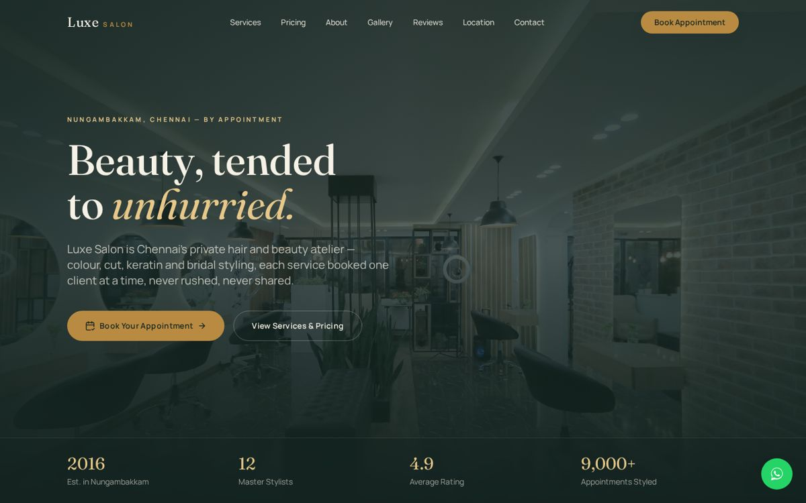
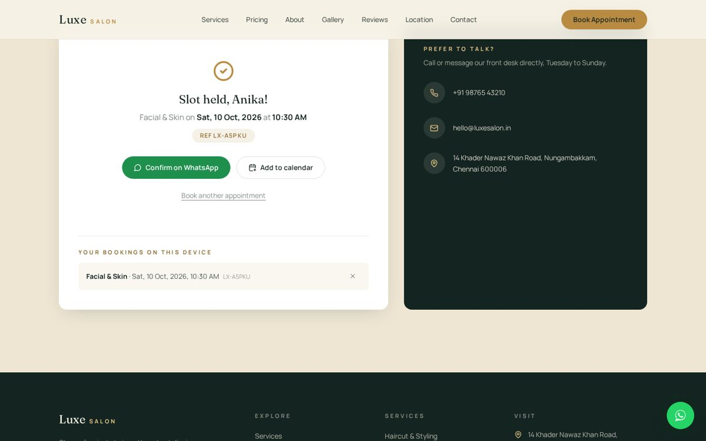

# Luxe Salon — Premium Landing Page + Working Booking Flow

**Live demo → https://salon-demo-website-nu.vercel.app**



A premium, single-page marketing site for a luxury salon in Chennai, built
with **React + Vite + Tailwind CSS**. Built as a client-style demo for a
web development portfolio — and the booking form actually books:

- **Live slot picker** — choose a service and a date; the site offers only
  start times that fit the salon's real opening hours (closed Mondays), the
  length of the service, and today's clock (a 60-minute buffer for same-day).
- **Validation** — name, Indian mobile number (normalised to `+91 xxxxx xxxxx`),
  date window (up to 60 days ahead) and slot, with inline, accessible errors.
- **Booking reference + confirmation** — every booking gets a reference such as
  `LX-7K2Q9`, a one-tap **"Confirm on WhatsApp"** message pre-filled with the
  details, and an **"Add to calendar"** `.ics` invite (Asia/Kolkata time).
- **"Your bookings on this device"** — bookings persist in `localStorage`, block
  overlapping slots for the next booking, and can be cancelled.



## Tech stack

React 18 · Vite 5 · Tailwind CSS 3 · framer-motion · lucide-react ·
`node:test` unit tests · GitHub Actions CI · deployed on Vercel.

The booking logic lives in [`src/lib/booking.js`](src/lib/booking.js) as pure,
framework-free functions (slots, validation, WhatsApp message, ICS), covered by
[`test/booking.test.js`](test/booking.test.js).

## Design concept

- **Palette:** deep pine ink (`#142420`), warm ivory (`#F6F1E6`), brass
  gold (`#B98B42`), and a muted wine accent (`#6E2A3B`) — evoking silk,
  brass and jasmine rather than a generic "spa" look.
- **Type:** `Fraunces` (a warm, editorial serif) for headlines paired
  with `Manrope` for body text and small caps labels.
- **Signature element:** a hand-drawn-style jasmine garland (`malli poo`)
  rendered in gold line-art (`JasmineDivider.jsx`), used as a recurring
  section divider — a nod to the jasmine strands worn and sold at real
  Chennai salons.

## Getting started

```bash
npm install
npm run dev     # http://localhost:5173
npm test        # unit tests for the booking logic
```

Then open the local URL Vite prints (usually `http://localhost:5173`).

To build for production:

```bash
npm run build
npm run preview
```

## Project structure

```
salon-demo-website/
├── index.html
├── package.json
├── postcss.config.js
├── tailwind.config.js
├── vite.config.js
├── public/
│   └── favicon.svg
└── src/
    ├── main.jsx
    ├── App.jsx
    ├── index.css
    ├── lib/
    │   └── booking.js           ← booking rules & helpers (unit-tested)
    └── components/
        ├── Navbar.jsx
        ├── Hero.jsx
        ├── JasmineDivider.jsx   ← signature section divider
        ├── Services.jsx
        ├── Pricing.jsx
        ├── About.jsx
        ├── Gallery.jsx
        ├── Testimonials.jsx
        ├── LocationMap.jsx
        ├── Contact.jsx          ← booking form (slots, validation, confirmation)
        ├── Footer.jsx
        └── WhatsAppButton.jsx
```

## Replacing placeholder content before handing off to a client

1. **Images** — every `` uses hotlinked Unsplash photos as
   stand-ins. Search each component for `images.unsplash.com` and swap
   in the client's real photography (recommended: 1600–2400px wide,
   `.jpg`/`.webp`).
2. **WhatsApp number** — set the real number in
   `src/components/WhatsAppButton.jsx` (`WHATSAPP_NUMBER`, E.164
   format, no `+` or spaces) and in `Contact.jsx` / `Footer.jsx`.
3. **Address, phone, email, hours** — update in `LocationMap.jsx`,
   `Contact.jsx`, and `Footer.jsx`.
4. **Google Map embed** — in `LocationMap.jsx`, go to Google Maps →
   Share → Embed a map → copy the exact `src` URL for the client's
   real location and replace the placeholder `iframe` `src`.
5. **Prices & services** — edit the arrays at the top of
   `Services.jsx` and `Pricing.jsx`.
6. **Booking rules** — opening hours, services, durations and prices for
   the booking form live at the top of `src/lib/booking.js` (`HOURS`,
   `SERVICES`, `SALON.whatsapp`). Bookings are confirmed over WhatsApp; to
   keep a central diary, post `createBooking()`'s object to a backend or
   a booking CRM in `handleSubmit` (`Contact.jsx`).
7. **Fonts/colors** — all design tokens live in `tailwind.config.js`
   under `theme.extend` — change them once, and the whole site
   updates.

## Notes

- Fully responsive from small mobile up through large desktop.
- Respects `prefers-reduced-motion`.
- All interactive elements have a visible keyboard focus state.
- Uses `framer-motion` for scroll-reveal and entrance animations, and
  `lucide-react` for icons.
